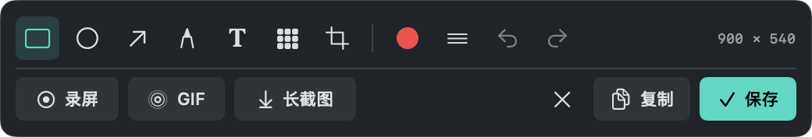

# SnapNest · 拾图

A native macOS screenshot, annotation, screen recording, and GIF capture app.

[MIT License](LICENSE) · macOS 15+ · Swift 6

一个原生 macOS 截图、标注编辑与录屏 / GIF 工具，SwiftUI + AppKit + ScreenCaptureKit 实现。所有内容仅保存于本机，无第三方依赖。



## 构建与运行

要求 **macOS 15+** 和 Swift 6 工具链（Xcode 或 Command Line Tools）。

```sh
git clone https://github.com/hdygxsj/SnapNest.git
cd SnapNest
./scripts/build-app.sh
open dist/拾图.app
```

也可将 `dist/拾图.app` 拖到“应用程序”文件夹，建议在固定位置完成授权。构建使用本机 ad-hoc 签名，未进行 Apple 公证，不是面向其他机器分发的正式签名安装包。

首次使用，点击“请求授权”，在系统设置 → 隐私与安全性 → 屏幕与系统音频录制中允许“拾图”。若授权后仍无法捕获，请退出后重新打开。重新构建替换二进制可能需要重新授权。

## 功能

- **⌘⇧X**：应用运行时，全局呼出区域截图。拖动后松开完成，Esc 或右键取消。长截图或录屏过程中，再按此快捷键结束捕获。
- **截图编辑器**：框选后截图原位显示，选区外显示半透明遮罩，裁剪后遮罩随选区更新；退出或切换录屏时移除遮罩。紧凑浮动工具条贴在选区下方；空间不足时自动移到上方或屏幕内。支持矩形、椭圆、箭头、画笔、文字、马赛克、裁剪、颜色与粗细、缩放、撤销 / 重做。默认框选完成即复制到剪贴板；点击选区和工具栏以外的位置、Esc 或关闭按钮可收起选区，并将当前编辑结果更新到剪贴板，随后可直接 ⌘V 粘贴。点击“复制”也会复制并退出，点击“保存”落盘；关闭、复制和保存后均不弹回主窗口。自动复制可在偏好设置关闭。⌘Z 撤销、⌘⇧Z 重做、⌘C 复制、⌘S 保存。
- **同一区域切换**：选区旁的工具条可将刚才的原始屏幕选区直接转为录屏、滚动长截图或 GIF，无需重新框选。标注和图片裁剪不会叠加到录制内容。
- **GIF 录制**：无声动图，10 fps，最长 30 秒，最长边 960 像素，循环播放。到达时长上限自动停止并导出，也可提前结束。
- **全屏截图**：捕获操作开始时鼠标所在显示器。
- **区域截图**：支持多显示器和 Retina，选区限制在单个显示器内。
- **滚动长截图**：框选滚动内容后，手动缓慢向下滚动，每次不超过半屏；约每 850ms 自动采样。浮动控制条显示已拼接帧数和高度。结束时点击停止按钮，或按 ⌘⇧X，再检查、标注并保存。
- **全屏 / 区域录屏**：三秒倒计时，MP4 / H.264，30fps，最高 3840×2160（保持比例）。可在设置关闭系统声音，不采集麦克风。
- **剪贴板与文件**：在编辑器点击“保存”后，默认保存 PNG 并复制到剪贴板，可关闭自动复制。默认保存到 `~/Pictures/拾图`，设置中可改位置。
- **历史**：保留最近 30 条文件引用，可复制图片、使用默认应用预览、在 Finder 定位；不自动删除实际文件。
- **菜单栏**：关闭主窗口后继续运行；点击菜单栏图标可重新打开、开始捕获或停止录制。

## 长截图使用建议

选区只包含滚动正文，避开固定导航栏、悬浮按钮、视频和动态内容。每滚动一小段稍作停顿，给自动采样留出时间。暂不自动控制网页滚动，也不支持横向拼接。

匹配不可靠时不会追加帧，会提示稍向上回滚再缓慢向下。纯色区域、重复图案、动画、过快滚动或布局变化可能无法对齐。单图限制为 8000 万像素或 40000 像素高，达到上限自动结束并打开已拼接内容供编辑保存。

## 项目结构

- `Sources/ShituCore`：坐标转换、重叠匹配、图像拼接。
- `Sources/Shitu`：界面、全局快捷键、区域选择、截图和录屏、保存与权限引导。
- `Tests/ShituCoreTests`：可执行核心测试（不依赖完整 Xcode 的 XCTest）。
- `scripts/build-app.sh`：Release 编译、生成 `.app` 并校验本机签名。

```sh
swift run ShituCoreChecks
swift run Shitu --verify-editor
swift build
./scripts/build-app.sh
```

核心测试覆盖负坐标显示器、边界裁剪、滚动匹配、重复帧、无效输入、无法匹配的图像、轻微噪声，以及真实 CGImage 多帧拼接的高度和逐像素顺序。

捕获使用 Apple [SCStreamConfiguration](https://developer.apple.com/documentation/screencapturekit/scstreamconfiguration) 与 [SCStream](https://developer.apple.com/documentation/screencapturekit/scstream)。界面和菜单不需要辅助功能权限；捕获需要用户授予系统录屏权限。

GIF 自动化验证会用合成视频导出真实 GIF，并检查帧数、尺寸、帧间隔和循环参数；编辑器检查标注像素、马赛克、裁剪及撤销 / 重做。可用 `open dist/拾图.app --args --demo-editor` 打开不需要录屏权限的示例编辑器（先退出已运行的拾图）。

## 系统提示“用户拒绝了…捕捉的 TCC”

这表示 macOS 拒绝了当前进程的实际屏幕捕获请求。权限开关看起来开启，并不一定代表刚更新的开发版已经获得授权。

1. 在系统设置 → 隐私与安全性 → 屏幕与系统音频录制，关闭再开启“拾图”。
2. 完全退出拾图并重新打开。在设置页点击“检查实际捕获权限”。
3. 仍失败时，从系统列表移除旧拾图条目，再用应用中的“定位当前应用”找到当前 `.app`，重新添加并授权。

应用不会自行重置 TCC 数据库或代替用户授予权限。系统拒绝后，应用会显示恢复入口；不会因预检查返回 true 就清除实际拒绝状态。

构建脚本现在拒绝覆盖仍在运行的拾图。默认使用本机临时签名，因此更新二进制后可能需要重新授权。若已配置稳定的 Apple 开发或分发证书，可使用：

```sh
SHITU_SIGNING_IDENTITY='证书名称或 SHA-1' ./scripts/build-app.sh
```

## 登录时自动启动

打开“偏好设置”，开启“登录时自动启动”。使用 macOS 原生 [SMAppService.mainApp](https://developer.apple.com/documentation/servicemanagement/smappservice/mainapp) 注册，登录 Mac 后自动打开拾图；关闭开关即可移除登录项。

若状态为“等待系统允许”，点击“打开登录项设置”完成系统批准。设置会在应用重新激活时与系统同步，不以本地布尔值假装注册成功。建议从固定位置运行 `.app`，移动应用后重新检查登录项。


## 贡献

欢迎提交 Issue 和 Pull Request。构建、验证步骤见 [CONTRIBUTING.md](CONTRIBUTING.md)，当前验证范围见 [docs/verification.md](docs/verification.md)。

## 许可证

本项目使用 [MIT License](LICENSE)。Copyright © 2026 hdygxsj。

## 菜单栏与版本更新

关闭主窗口后，拾图收起到顶部菜单栏继续运行，⌘⇧X 仍然有效。点击菜单栏“拾图”展开快捷面板，可截图、录屏、录 GIF、截长图或重新打开主界面；右键打开菜单。只有“退出拾图”或 ⌘Q 才退出进程，正在捕捉时会阻止退出。

在偏好设置或菜单栏选择“检查更新”，可查看 GitHub 最新正式 Release 的说明并下载通用安装包。默认启动时每天最多自动检查一次，可在更新窗口关闭。发现新版本时菜单栏显示 ↑。下载后在 Finder 显示安装包：解压、退出拾图，将新版拖入“应用程序”替换旧版，再重新打开。当前提供检查及下载安装包，不会自动替换正在运行的应用。
